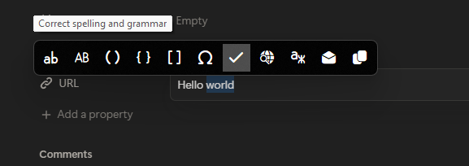
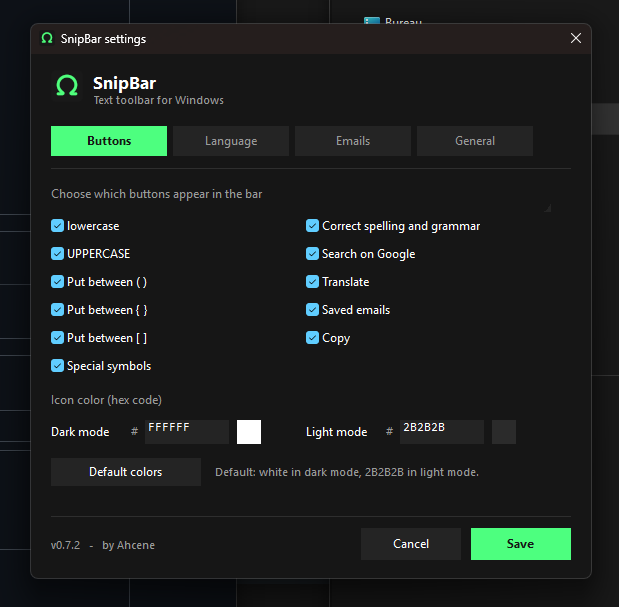

Sorry first of all if it detects like a virus in the .exe I don't know how to solve that, its a vibe coded app so am not good in coding, if does not work try to launch it with the snipbar.ahk script by installing autohotkey 2 :) everything is in the folder just choose the last version

New version 0.9.4 allow you to change the design of the bar in the settings and also add or remove symbols of your choice.

# SnipBar
A small, free floating action bar for Windows: maybe alternative to pantherbar or SnipDo select some text with your mouse and a bar of one-click actions appears right above it. Built with AutoHotkey v2. Inspired by tools like SnipDo, but free and lightweight.

---

## What it does

Select text in any app and a pill-shaped bar pops up above the selection. Click a button and the action runs instantly:

| Button | Action |
|--------|--------|
| **abc** | Convert to lowercase |
| **ABC** | Convert to UPPERCASE |
| **( )** | Wrap the selection in parentheses |
| **{ }** | Wrap the selection in curly braces |
| **Symbols** | Open a mini-bar of characters you tend to forget the Alt codes for (• ■ É È Œ œ). Click one to replace the selection. |
| **Google** | Search the selection in your default browser |
| **Translate** | Translate to English by default (the language can be changed) |
| **Copy** | Copy the selection |

You choose which buttons are shown in the settings.

## Design and performance

- Black pill with white round icons at about 70% opacity (opacity is adjustable at the top of the script with `BarOpacity`)
- No blur effects and no screenshots of your screen: very low CPU/GPU usage
- Nothing is written to disk besides your settings
- Can start automatically with Windows

---

## Installation

### Option 1: with AutoHotkey (recommended)
1. Install [AutoHotkey v2](https://www.autohotkey.com/)
2. Download `SnipBar.ahk`
3. Double-click it. A tray icon appears.
4. Select some text anywhere and the bar shows up

### Option 2: standalone `.exe`
Download `SnipBar.exe`. No AutoHotkey needed.
> Windows SmartScreen or your antivirus may warn about unsigned AutoHotkey executables. The full source code is in this repository so you can check it or compile it yourself.

### Start with Windows
Put a shortcut to the script in your Startup folder (`Win+R`, type `shell:startup`, press Enter).

---

## Customize

Open the settings from the tray icon to:
- Pick which buttons appear on the bar
- Change the translation language
- Turn autostart on or off

## Requirements
- Windows 10 or 11
- AutoHotkey v2, unless you use the `.exe`

## License
MIT. Free to use, modify and share. See [LICENSE](LICENSE).

## Author
Made by Ahcene. Feedback, bug reports and ideas are welcome in the [Issues](../../issues) tab.
